# Reelty

**A desktop AI assistant that turns a phone walkthrough of a property into marketing videos.**

> [!NOTE]
> **The source code is private for now.** This repo only holds the README, the screen recording and the screenshots. I'm happy to walk you through the code on request: email me at [chisometi@gmail.com](mailto:chisometi@gmail.com).

Upload the walkthrough, say what you want in plain words ("a video tour with my logo and a price intro", "a playful Just listed reel"), and Reelty finds the rooms, plans the edit, renders it and shows the result in the chat. You can watch every step as it works.

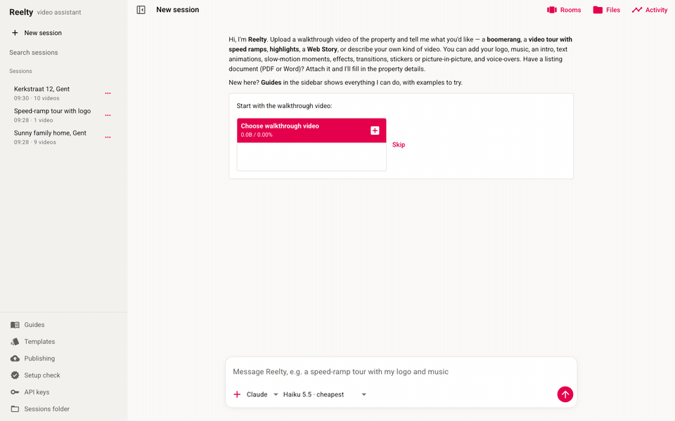

A real request, recorded in the app: Reelty checks the session, reads the format guide, plans the edit and renders the tour (sped up while it waits). [MP4 version](docs/demo.mp4)

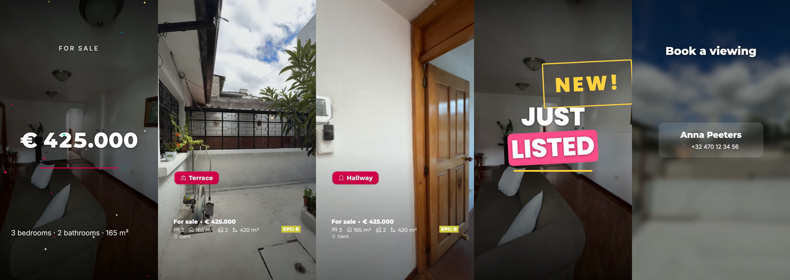

---

## What it does

| | |
|---|---|
| **Finds the rooms** | On-device models label every room in the walkthrough. Reelty checks a still of each room and fixes wrong labels; you can rename, cut, join or split rooms in the Rooms panel. |
| **Makes the videos** | Boomerang, a full video tour with speed ramps, a 15–25 s highlights teaser, or any kind of video you describe (a reel, a single-room spotlight, a reverse reveal…). Square, portrait, 4:5 or landscape, with transitions. |
| **Motion graphics** | Animated intros, outros, price reveals, "Just listed", stats, open house, sold stamps, logo reveals, room slideshows, lower thirds and stickers, in six styles, made with [Remotion](https://www.remotion.dev). Every text, colour, font and animation can be changed by asking. |
| **A consistent look** | Every video gets the Reelty look by default: a property footer (price, specs with icons, EPC label, address) and a room label as each room starts. You can design your own look and save it as a template for every property. |
| **Edits on request** | Slow motion, animated text, colour looks, zooms, flashes, overlays and picture-in-picture, logos, music that ducks under voice-overs. |
| **AI photo edits** | Virtual staging, clean-up, day to night, seasons and holiday decorations on any frame, with Gemini, shown before/after and revealed inside the video, with a "Virtually staged" label by default. |
| **Web Story** | A tap-through mobile story of the property (AMP Web Story) in the same look. |
| **Publishing** | Netlify (one link per property), Google Cloud Storage, WordPress posts that play the story, and posts to Instagram Reels, TikTok and Facebook through Metricool, always approved by you first. |
| **Reads listings** | Upload a PDF, Word file or a photo of a listing; Reelty fills in the property details and asks only for what's missing. |
| **Built-in guides** | Tutorials for every feature, with example requests you can try with one click. |

## Screenshots

**The chat.** Reelty's thinking, each tool step with its timing, and the finished video, all in the conversation. Every session is saved and can be reopened.

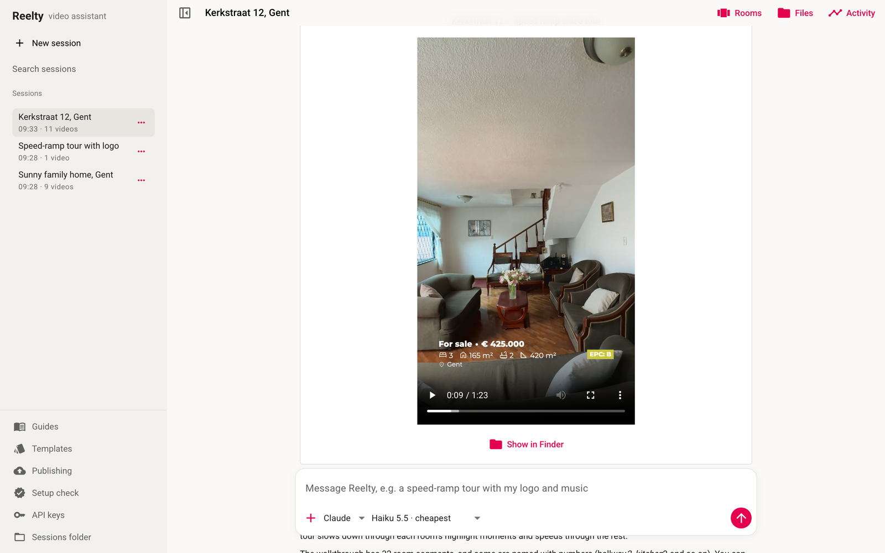

| Live steps and progress | Motion-graphics previews |
|---|---|
| 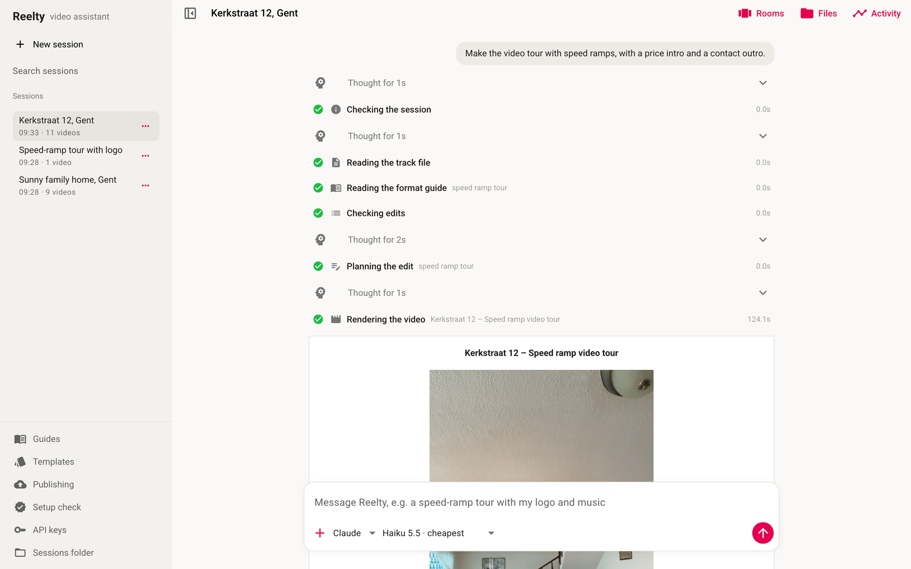 | 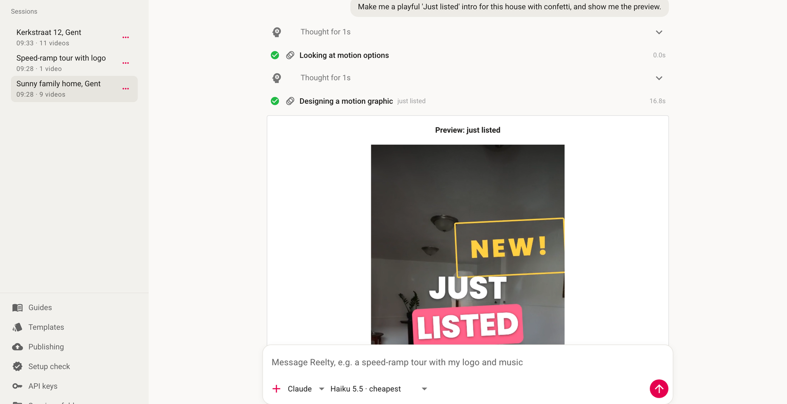 |

| Rooms panel | Built-in guides |
|---|---|
| 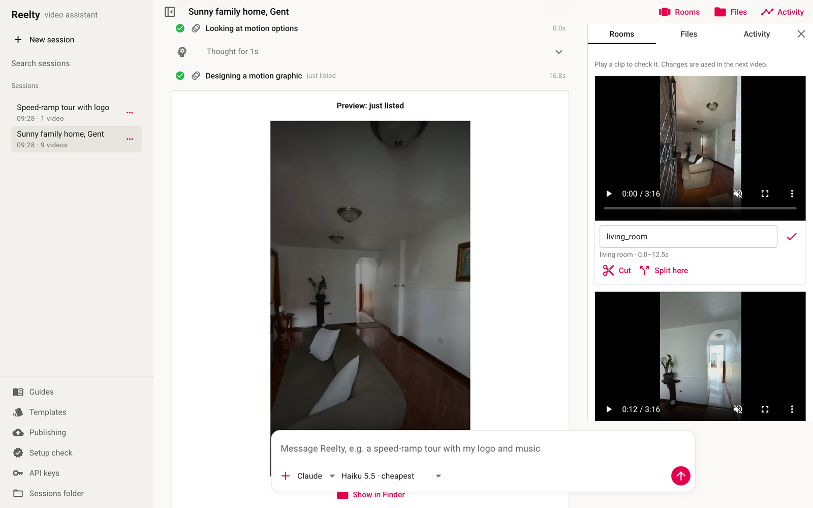 | 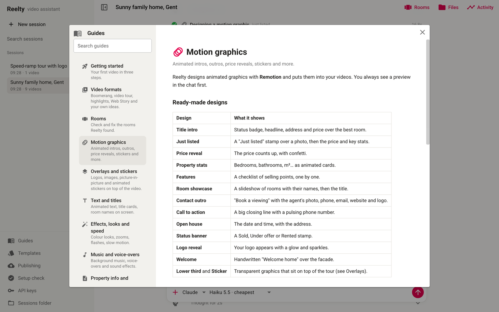 |

| Templates (looks) | Publishing |
|---|---|
| 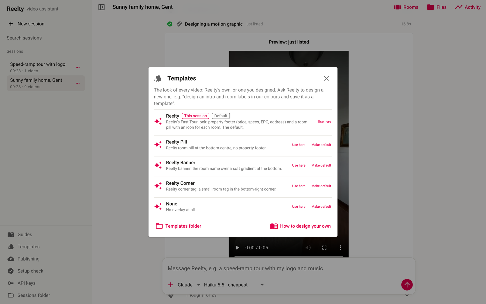 | 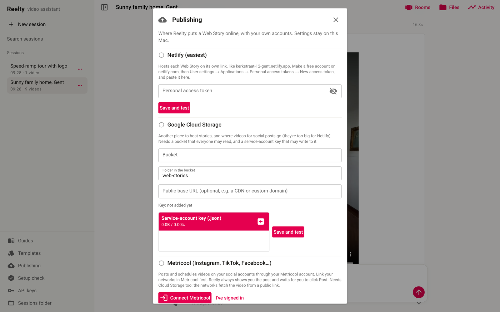 |

| Setup check | Model choice |
|---|---|
| 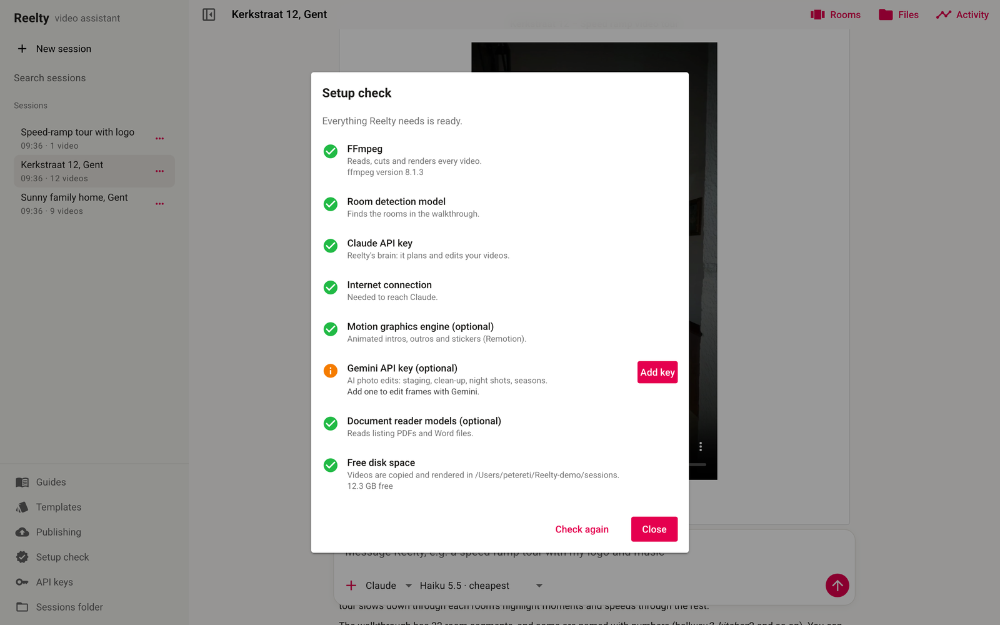 | 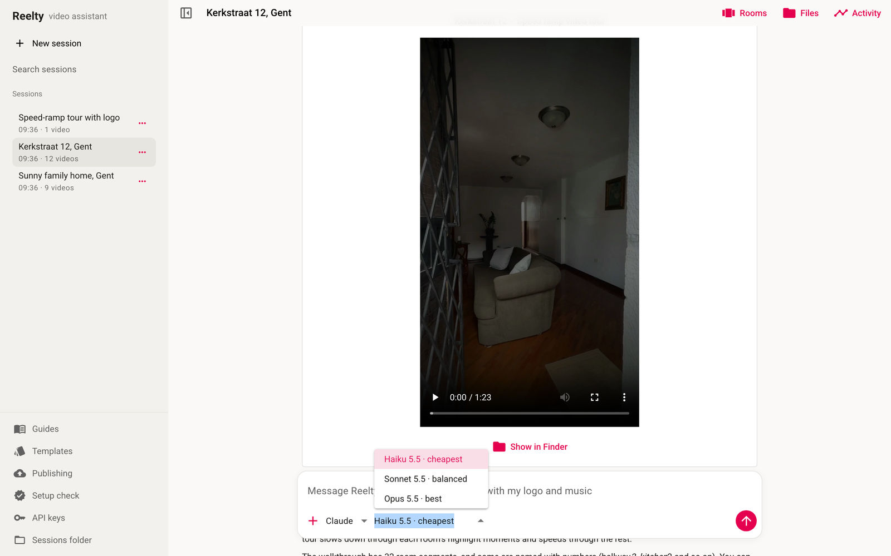 |

| Web Story: cover | Web Story: a room |
|---|---|
| 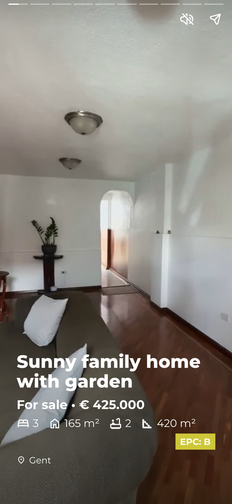 | 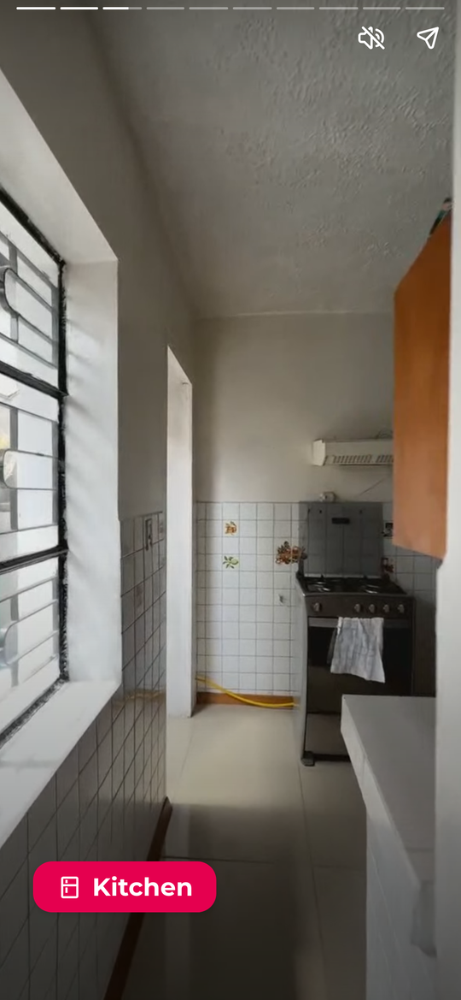 |

## How it works

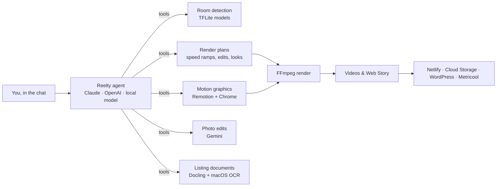

- **The agent** runs a tool loop: it streams its thinking into the chat, calls tools (find rooms, build a plan, design a motion graphic, render…), reads their results and keeps going until the job is done. A checklist shows its plan for longer requests, and **Stop** halts it at any moment.
- **Render plans** describe the edit as data (rooms, speeds, ramps, overlays, intro/outro), and a compiler turns them into one FFmpeg command, so standard formats come out with exact timing. For anything a plan can't express, Claude may write FFmpeg itself, sandboxed to the session folder.
- **Motion graphics** are JSON specs (scenes → background + layers, each with enter, exit and loop animations) rendered by a bundled Remotion project. Reelty only fills in specs; it never writes code for them.
- **Sessions** live in `~/Reelty/sessions/<id>/` with `inputs/`, `work/` and `outputs/`, plus the chat, so you can reopen and continue any of them.

## AI models

| Job | Model | Where it runs |
|---|---|---|
| The assistant (planning, editing, writing) | **Claude Haiku 5.5** by default; Sonnet 5.5 or Opus 5.5 to choose from. OpenAI models (e.g. GPT‑5 mini) with an OpenAI key. | Anthropic / OpenAI API |
| The assistant, offline and free | **Qwen3‑VL 4B** through a private Ollama server bundled in the app (~3.3 GB download, asked first) | On your Mac |
| Room detection | **Places365 ResNet‑18** scene model + a furniture/frame model (TFLite) | On your Mac |
| Reading listings | **Docling** with macOS Vision OCR for scans | On your Mac |
| Photo edits (staging, clean-up, night…) | **Gemini** image model (`gemini-3-pro-image-preview`, configurable) | Google API |
| Motion graphics | **Remotion** 4 with a headless Chrome (~600 MB, downloaded once, asked first) | On your Mac |
| Social posting | **Metricool** through its MCP server | Metricool |

Pick the provider and model next to the message box; switching keeps the conversation. Haiku is the cheapest and handled a full job in testing (rooms → tour → price intro → contact outro); Opus is best for complex custom requests.

## Safety

- **Your words are the only instructions.** Text from uploaded documents is treated as data; if a document tries to instruct the AI, you see a warning and Reelty ignores it.
- **FFmpeg is sandboxed**: no network addresses, no files outside the session folder.
- **Nothing is published without you**: Reelty only publishes when asked, asks before making a WordPress post public, and social posts are sent only when you click **Post** on the card in the chat (enforced in the app, not just the prompt).
- **Keys stay on your Mac**, in `~/Library/Application Support/Reelty/` (owner-only files).
- Reelty only helps with property videos and politely declines anything else.

## Services it connects to

Set these up in the app (**API keys** and **Publishing** in the sidebar); each is explained in the built-in guides.

| Service | For | What you need |
|---|---|---|
| OpenAI | Using GPT models instead of Claude | An OpenAI API key |
| Gemini | AI photo edits | A Gemini API key |
| Netlify | Publishing Web Stories (easiest) | A personal access token |
| Google Cloud Storage | Hosting stories, and videos for social posts | A public-read bucket and a service-account key |
| WordPress | A post on your site that plays the story | Site address, username and an application password |
| Metricool | Posting to Instagram, TikTok, Facebook… | A Metricool account (sign in from the app) |

## Source code

The Reelty project is private for now, but I'm happy to walk you through the code if you'd like to see it. Email me at [chisometi@gmail.com](mailto:chisometi@gmail.com).
